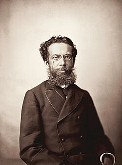

# ACartomanteRAG

**Inteligência documental e RAG sobre as obras de Machado de Assis.**

Acesso a aplicação publicada: [cartomante rag](https://acartomanterag.gustavodreis.dev.br)

[Rodar no notebook](docs/REPRODUCAO_LOCAL.md) · [Entender a arquitetura](docs/INFRA_ATUAL.md)

## Sobre o projeto

Comecei querendo construir um sistema de inteligência documental de ponta a ponta: definir requisitos, coletar PDFs em domínio público, entender sua estrutura, preparar os dados e consultar o acervo com um LLM, trazendo evidências concretas para as respostas. O projeto foi evoluindo conforme eu investigava a base e revisitava as obras de Machado.

Nesse caminho, trabalhei com extração e classificação de textos, identificação de obras duplicadas, divisão em chunks, embeddings e busca vetorial. Comparei estratégias de recuperação, reranking e geração de resumos auxiliares, combinando heurísticas, processamento de texto e LLMs. Os notebooks registram essa investigação; os pipelines transformam os experimentos em etapas reproduzíveis.

O valor da solução está em tornar um acervo consultável, recuperar informações espalhadas pelos documentos e permitir conferir a origem das respostas. A arquitetura também serve como base para outros domínios, como documentação técnica e acervos institucionais. Essa adaptação exige revisar a coleta, os metadados, as regras de preparação e os critérios de avaliação: trocar a pasta de PDFs é só o começo da conversa.

Acima de tudo, o propósito é **experimental e investigativo**: testar abordagens, modelos e estratégias, medir seus efeitos e entender suas limitações.

## A aplicação

A aplicação combina **FastAPI, LangGraph e recuperação com reranking e resumos auxiliares** contando com um ci/cd para publicação e deploy na aws . Tem histórico de conversas, evidências do texto original, respostas em Markdown e uma tiragem de cartas para escolher o guia de cada conversa. Também é possível trocar de guia ou seguir no modo neutro.

*O que será que cada guia sussurra à cartomante?*

## Por que RAG e não fine-tuning?

A prioridade aqui é consultar um acervo específico e vincular as respostas aos documentos. Com RAG, recupero trechos relevantes e os forneço ao modelo como contexto. Para acrescentar ou corrigir documentos, atualizo os dados e os índices, sem precisar retreinar o gerador.

Fine-tuning pode ajudar a adaptar comportamento, estilo ou tarefas específicas e pode complementar essa arquitetura. Sozinho, porém, não oferece o mecanismo de busca e rastreabilidade documental que quero investigar. Por isso, concentrei o trabalho inicial na qualidade do corpus, na recuperação das evidências e na avaliação das respostas.

## Machado de Assis: referência e homenagem

Machado é um dos meus autores preferidos, e o projeto também é uma pequena homenagem à sua obra. Se a conversa levar alguém de volta aos livros, já valeu uma parte das dores de cabeça com a infraestrutura.

<table>
  <tr>
    <td width="270" align="center" valign="bottom">
      
    </td>
    <td valign="bottom">
      

        <strong>Fundação da ABL</strong> 
        Foi um dos fundadores e o primeiro presidente da Academia Brasileira de Letras, de 1897 até sua morte, em 1908.
        <a href="https://www.academia.org.br/academicos/machado-de-assis/biografia">Fonte: ABL</a>.
      

      

        <strong>Um marco literário</strong> 
        <em>Memórias Póstumas de Brás Cubas</em>, publicado em livro em 1881, marcou a passagem do Romantismo ao Realismo na literatura brasileira.
        <a href="https://www.bpp.pr.gov.br/Candido/Pagina/Especial-Fragmentacao-Literaria-Prateleira">Fonte: Biblioteca Pública do Paraná</a>.
      

      

        <strong>Reconhecimento</strong> 
        Seu nome batiza o Prêmio Machado de Assis, concedido pela ABL a escritores pelo conjunto da obra.
        <a href="https://www.academia.org.br/academia/premios">Fonte: ABL</a>.
      

    </td>
  </tr>
</table>

Foto: Marc Ferrez, 1890; restauração de Adam Cuerden. Domínio público. <a href="https://pt.wikipedia.org/wiki/Ficheiro:Machado_de_Assis_by_Marc_Ferrez.jpg">Origem e créditos</a>.

## Para começar

| Quero… | Caminho |
| --- | --- |
| Rodar no meu notebook | [Reprodução local](docs/REPRODUCAO_LOCAL.md) |
| Publicar na minha conta AWS | [Reprodução AWS](docs/REPRODUCAO_AWS.md) |
| Entender serviços, acessos e recuperação | [Infra atual](docs/INFRA_ATUAL.md) |
| Entender camadas, vetores e releases | [Arquitetura de dados](docs/ARQUITETURA_DADOS.md) |
| Examinar ou repetir avaliações | [Benchmarks](docs/BENCHMARKS.md) |
| Desenvolver e abrir um PR | [Contribuição](CONTRIBUTING.md) |
| Consultar as limitações encontradas | [Impedimentos](docs/IMPEDITIVOS.md) |

**Raspberry e Gitea são particulares à minha execução; não são requisitos para reproduzir o projeto.** No notebook uso Docker e Ollama. Na AWS, GitHub Actions publica a aplicação e dispara os jobs.

As motivações estão em [Objetivos](docs/Obejtivos.md), [Metas e conclusão](docs/METAS_E_CONCLUSAO.MD) e [IA no desenvolvimento](docs/IA_NO_DESENVOLVIMENTO.MD).

## Futuro do projeto

Bem, eu ainda quero testar muitas abordagens e criar aplicações em cima dessa base e dos conhecimentos adquiridos durante o desenvolvimento. Gostaria de ter fechado um minigame nesta primeira entrega, mas isso ampliaria demais o escopo e acabaria levando mais tempo.

Quero continuar testando técnicas para melhorar a organização das informações e a avaliação dos resultados de recuperação e geração. Ainda há um mundo de desafios à espera.

> “Cada estação da vida é uma edição, que corrige a anterior, e que será corrigida também, até a edição definitiva, que o editor dá de graça aos vermes.”
>
> — Machado de Assis
