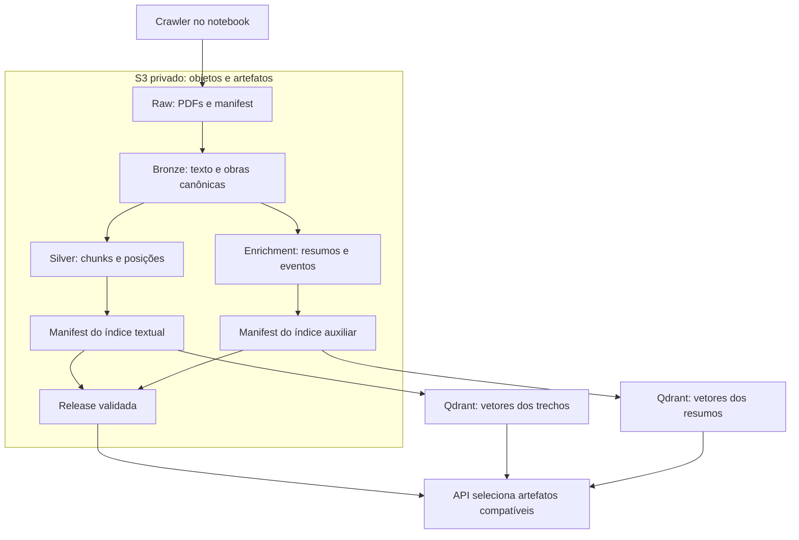

# Arquitetura dos dados

Separei o documento original, o texto preparado e o que o modelo produziu. Assim consigo reconstruir um índice, investigar uma resposta e trocar o gerador sem tratar um resumo como se fosse o próprio Machado.

## Do PDF à release

Depois do Raw, o Glue executa as transformações e grava os objetos e as collections. No notebook, os mesmos módulos usam RustFS e Qdrant local. **S3 guarda arquivos; Qdrant faz a busca vetorial.** O corpus não é carregado inteiro na pergunta HTTP.

| Camada | Conteúdo e papel |
| --- | --- |
| Raw | PDFs, consulta, estado de cada download e validação das páginas. Na AWS: `production/raw/<raw_id>/`. |
| Bronze | Texto extraído, classificação e seleção canônica; reduz duplicações de edições e arquivos. |
| Silver | Chunks, posições e parâmetros. Configuração atual: fixed, 256 tokens, overlap 32, tokenizer RoBERTaCrawlPT. |
| Índice textual | Embeddings Colibri de 768 dimensões, cosine, payloads no Qdrant e manifest no bucket de índices. |
| Enrichment | `resumo`/`eventos` por unidade e `resumo_geral`/`eventos_principais` por obra, com checkpoints no S3. |
| Índice auxiliar | Embeddings dos resumos, recuperados como apoio ao contexto. |
| Release | Referências compatíveis para os artefatos; o ponteiro AWS é `production/current.json`, no bucket de índices. |

Existem buckets separados para Raw, Bronze, Silver, índices, enrichment, benchmarks e operação. O state Terraform usa outro bucket, privado e versionado. Redis guarda conversas, checkpoints do grafo e contadores; sua recuperação está na [Infra atual](INFRA_ATUAL.md#operar-e-recuperar).

## Manifests, retomada e publicação

O Raw só publica `ready.json` depois de validar a coleta. Falhas ficam no manifest para retry; indisponibilidades confirmadas têm motivo explícito. Snapshot pronto é imutável. Na coleta registrada, 321 entradas resultaram em 318 PDFs disponíveis; isso não equivale ao total de obras canônicas.

O ETL mantém checkpoint em `production/runs/<run_id>.json`. Etapas concluídas são reutilizadas; no enrichment, unidades e obras prontas são preservadas. Pendências bloqueiam índice auxiliar e promoção. Uma release parcial não vira completa porque terminou o tempo de espera.

`raw_id` identifica a coleta; `run_id`, o processamento; `revision`, o código; `jr_...`, uma tentativa Glue. Preserve os três primeiros ao retomar. O [guia AWS](REPRODUCAO_AWS.md#retomar-e-diagnosticar-o-etl) descreve acompanhamento e migração de revisão.

Construir cria um candidato; promover escolhe o conjunto servido. Código e dados têm ciclos próprios: uma feature não precisa recriar o corpus. Um rollback de dados seleciona uma release anterior compatível.

## Reproduzir a mesma recuperação

O comportamento fica nos YAMLs de `config/`; endpoints e segredos ficam nos arquivos privados ou SSM. Um `retrieval_index.index_id` explícito tem precedência sobre a release. Na AWS ele fica vazio; em instalação local, publique sua própria release ou use seu próprio índice.

Repetir um experimento exige snapshot, parâmetros e revisões dos modelos, além do commit. O perfil AWS fixa tokenizer, Colibri e CrossEncoder; referências locais `main` precisam ser resolvidas para SHAs quando a repetição exata importar. Trocar o embedder exige índice compatível.

O enrichment é apoio derivado `[R]`; a evidência citável continua no original `[E]`. Na AWS, `fail_open=false` exige os artefatos completos. O fallback local existe para desenvolver por etapas, não para comprovar o funcionamento de um índice ausente.
