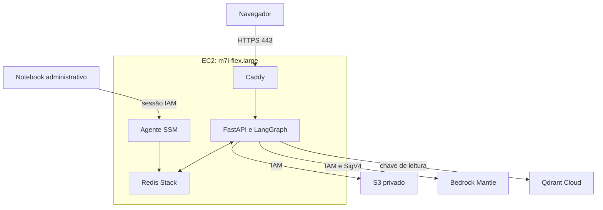
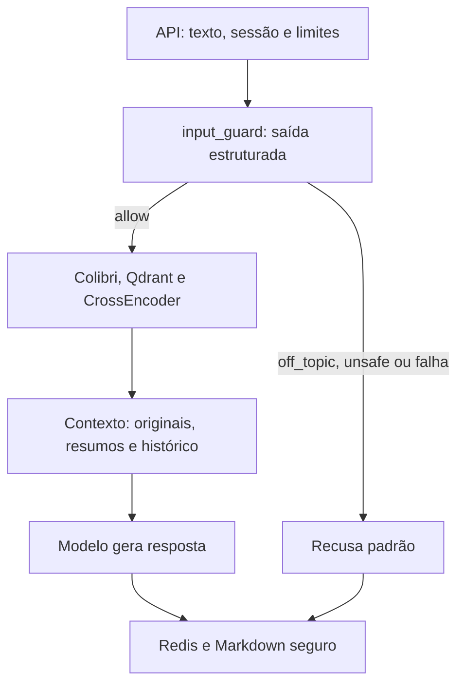

# Infra atual

A aplicação é um monólito modular: FastAPI serve interface e API; LangGraph conduz as perguntas. Coleta, preparação e benchmark são jobs separados. Subir o chat não dispara a preparação do corpus inteiro — a máquina já tem preocupações suficientes.

## Serviços e acessos



| Parte | Responsabilidade |
| --- | --- |
| EC2, EIP e EBS | Um host, IP estável e persistência em `/srv/acartomante/data`. Caddy, API e Redis rodam em containers. |
| S3 e Qdrant Cloud | Objetos e artefatos no S3; pesquisa vetorial no Qdrant. Veja [Arquitetura de dados](ARQUITETURA_DADOS.md). |
| Bedrock | Qwen3 32B via Mantle para guard, chat e enrichment; Scout via Converse no benchmark. |
| Glue | ETL em CPU, dois workers `G.1X`, timeout de 600 minutos e uma execução simultânea. |
| ECR e SSM | Imagem da aplicação, deploy, recarga, manutenção e parâmetros privados. |

Só 443 é pública. API 8000 fica interna; Redis tem bind `127.0.0.1:6379` no host para túnel SSM. Não há SSH ou Redis abertos à internet. Qdrant separa chave de leitura da aplicação e escrita do ETL. OIDC e o escopo das roles estão no [guia AWS](REPRODUCAO_AWS.md#permissões-da-automação).

No notebook, RustFS substitui S3, Qdrant roda em Docker e Ollama fornece o modelo. O Raspberry é particular ao meu homelab: mantém Gitea e espelho GitHub; o runtime está suspenso. Quem publica na AWS é o GitHub. Uma instalação própria pode usá-lo diretamente.

A publicação segue GitHub → CI → ECR → deploy SSM na EC2. As identidades têm responsabilidades distintas:

| Identidade | Escopo definido no código |
| --- | --- |
| Perfil local `terraform` | Administração da fundação e IAM |
| GitHub infra | Plano e operações permitidas nos recursos existentes |
| GitHub deploy | Imagem ECR e acionamento do deploy SSM |
| GitHub ETL | Jobs, promoção de dados e MCQ |
| EC2 / Glue | Leitura e inferência do atendimento / escrita e inferência do ETL |

Em contas antigas, esse escopo depende de aplicar a transição IAM e conferir as políticas reais.

## O caminho de uma pergunta



O guard é um node do LangGraph e chama o modelo antes do retrieval. Quando permite, Colibri gera o vetor na CPU, Qdrant busca 25 candidatos e CrossEncoder seleciona até dez. Até três resumos auxiliam a resposta. Há outra chamada ao modelo para gerar a resposta literária.

O contexto tem até 20.000 caracteres, com até 5.000 efetivos para enrichment e três turnos de histórico. A geração usa temperatura 0,1 e até 1.024 tokens. O original aparece como `[E]`; o resumo derivado, como `[R]`.

## Interface e proteção

A sessão anônima usa cookie de 30 dias, `HttpOnly`, `SameSite=Lax` e HTTPS na AWS. Cada sessão acessa suas próprias conversas. O tutorial aparece na primeira visita; cada novo chat embaralha duas cartas de mesmo verso, revela o guia escolhido e permite trocar de persona ou seguir neutro.

A API aceita texto e os metadados previstos nos schemas, sem uploads ou ferramentas de execução de código. Markdown tem HTML bruto e imagens desabilitados, com bloqueio de links inseguros. O guard complementa essas barreiras; não oferece garantia contra toda tentativa de manipulação.

| Limite | Valor |
| --- | --- |
| Mensagem / título | 4.000 / 120 caracteres; campos extras recusados |
| Corpo HTTP / leitura | 32.768 bytes / 10 segundos |
| Requisições API | 60/min por IP; 600/min global |
| Mensagens | 6/min por IP |
| Novas conversas | 5/min e 30/dia por IP; 300/dia global |
| Geração AWS | 6 turnos/min por sessão; 300/dia UTC no total |
| Concorrência | Duas perguntas por worker; um worker, sem fila |

Trocar cookie não reinicia limites por IP. Caddy sobrescreve o IP real e a API confia só na rede do proxy. Violações retornam 413/415/422; rate limit retorna 429 com `Retry-After`; Redis indisponível ou capacidade esgotada retornam 503. Assets e verificações de saúde ficam fora do contador HTTP.

## Operar e recuperar

No notebook, com perfil AWS administrativo, venv, dependências `ops` e plugin Session Manager:

```bash
python scripts/cloud.py usage
python scripts/cloud.py redis-tunnel
```

Deixe o túnel aberto. Em outro terminal com o mesmo perfil, obtenha a senha com `python scripts/cloud.py redis-password`. No RedisInsight desktop: `127.0.0.1:16379`, usuário `inspector`, senha retornada e TLS local desativado. O transporte usa SSM; a ACL é de leitura e não permite `MONITOR`.

`usage` mostra contadores, recusas, tokens e custo estimado por dia UTC; retenção de 14 dias. Sessões não são pessoas. Logs Docker registram rota, status e duração, sem perguntas; não há envio automático ao CloudWatch. EC2 fornece CPU, rede e status; RAM e disco exigem instrumentação adicional.

Redis usa AOF no EBS e backup diário no S3, com retenção de 30 dias:

```bash
python scripts/cloud.py admin backup
python scripts/cloud.py admin restart
python scripts/cloud.py admin restore --key backups/ANO/MES/DIA/HORARIO.rdb
python scripts/cloud.py data-rollback --run-id RELEASE_ANTERIOR
```

A restauração valida o RDB e preserva a pasta anterior. Rollback dos dados troca a release; rollback da imagem pertence ao deploy. Teste essas recuperações com artefatos conhecidos antes de depender delas.

**Emergência:** `make aws-stop GITHUB_REPO=SEU_USUARIO/SEU_REPOSITORIO` grava a trava Ops e solicita parada de Glue e EC2. `make aws-resume` com o mesmo repositório inicia a EC2 e libera operações; aguarde aquecimento. ETL não reinicia sozinho. Confira tarefas já em andamento e falhas parciais.

Há um único host, sem réplica de alta disponibilidade. EBS, S3 e IP podem continuar custando com a aplicação parada. Backup, limites e orçamento ajudam na operação; não formam um teto financeiro.
