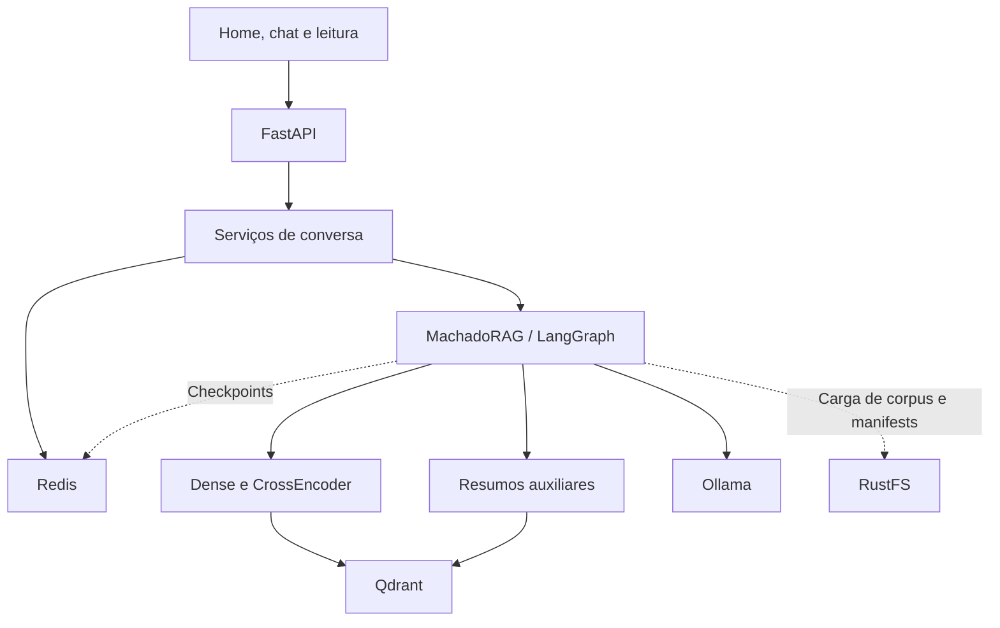
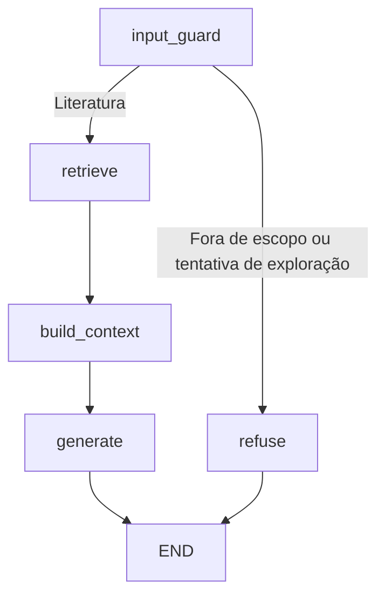

# Da exploração do corpus à arquitetura do ACartomanteRAG

Olá, caros leitores. Este documento continua o caminho que comecei nos notebooks: entender as obras que eu tinha em mãos, preparar os dados e descobrir como transformá-los em uma aplicação com LLM local. A proposta do ACartomanteRAG é permitir uma conversa sobre Machado de Assis acompanhada dos trechos que ajudaram a construir a resposta.

Quis usar esse projeto também como um laboratório de LLMOps. Portanto, além de fazer o chat responder, me interessava conseguir explicar de onde vieram os dados, qual índice estava sendo consultado e por que uma configuração acabou entrando na aplicação. Foi daí que surgiu a organização descrita aqui.

Para acompanhar as escolhas experimentais, deixei um [relato dos resultados e aprendizados](RESULTS_AND_LEARNINGS.md). Os comandos para executar a aplicação estão em [execução local e rede](INFRA_LOCAL_AND_DEPLOYMENT.md).

## Primeiro, entender o que eu estava colocando no RAG

No [ExploreCorpus](../AED/ExploreCorpus.ipynb), percebi que baixar os PDFs não resolvia a preparação da base. Havia informações institucionais antes das histórias, diferenças entre as fontes e até um registro cujo PDF não estava disponível. Se eu simplesmente transformasse tudo em chunks, parte da recuperação seria feita sobre esse material que não pertence ao texto literário.

Segui então por heurísticas de limpeza, investigando os padrões de cada fonte e conferindo amostras manualmente. Era um trabalho trabalhoso, mas computacionalmente simples e barato. Como eu já precisaria olhar os dados para saber se a limpeza estava funcionando, essa abordagem fazia sentido. Mantive o original na Raw para poder voltar à fonte quando surgissem dúvidas.

Depois vieram as divisões internas das obras. No [notebook de capítulos](../AED/ExploreEstrategiaExtracaoCapitulos.ipynb), encontrei capítulos numerados de formas diferentes, títulos confundidos com a primeira frase da prosa e o caso de *Na Arca*, com capítulos A, B e C. Em *Dom Casmurro*, a própria fonte tinha problemas de numeração. Isso me obrigou a separar duas questões: uma falha da minha extração e uma característica que já estava no PDF.

A investigação ainda revelou poemas, cânticos e peças teatrais que mereciam tratamento próprio. Voltei a essa questão no [ClassificacaoObras](../AED/ClassificacaoObras.ipynb), usando sinais como linhas curtas, assinaturas e locutores recorrentes. Fui ajustando os critérios conforme apareciam falsos positivos, sem transformar a classificação em uma tentativa de resolver toda a catalogação literária de Machado.

Esses achados explicam por que existe uma etapa de preparação antes dos modelos. Também explicam por que deixei tanto o chunking fixo quanto o híbrido disponíveis: conhecer a estrutura do corpus me deu uma hipótese para testar, e os benchmarks ajudaram a decidir o que usar no produto.

## Transformando a exploração em um pipeline

Organizei o trabalho em etapas que podem ser executadas e inspecionadas separadamente. A construção dos dados e dos índices acontece fora do atendimento web; abrir a aplicação não dispara uma nova ingestão nem reconstrói o corpus.

| Etapa | O que faço nela | Artefato que segue adiante |
|---|---|---|
| Raw | Baixo os PDFs do Domínio Público/MEC e registro origem e SHA-256. A deduplicação considera a URL de detalhe, preservando registros de versões diferentes de uma obra. | PDFs e manifest de ingestão. |
| Bronze | Extraio o texto, removo os cabeçalhos conhecidos, classifico as obras e seleciono uma versão canônica por título. | Texto preparado e metadados das obras. |
| Silver | Divido o texto em chunks com identificadores e referências à origem. `fixed` usa janelas de tokens; `hybrid` aproveita seções consideradas confiáveis e recorre ao fixo quando necessário. | Dataset de chunks versionado. |
| Índice textual | Calculo os embeddings e publico os vetores no Qdrant. Registro qual Silver, modelo, revisão, dimensão e distância deram origem ao índice. | Collection e manifest de índice. |
| Enrichment | Produzo resumos e eventos de unidades e obras. Depois indexo documentos `section_summary` e `work_summary`, sem dividir novamente esses resumos em chunks. | Corpus derivado e índices auxiliares. |
| Benchmark | Comparo as alternativas usando os módulos do projeto e salvo configuração, resultados e relatórios por execução. | Runs rastreáveis para orientar a escolha do runtime. |

Na Bronze, a escolha canônica prefere uma fonte cujo nome contenha “Universidade”, depois mais acessos e, no desempate, o menor `document_id`. É uma regra operacional determinística para selecionar versões; ela não demonstra que uma edição é textualmente superior às demais.

Os artefatos ficam no RustFS, nos buckets `acartomante-raw`, `acartomante-bronze`, `acartomante-silver`, `acartomante-indexes`, `acartomante-enrichment` e `acartomante-benchmarks`. Uso versões próprias para manter os resultados anteriores; `current.json` e as releases funcionam como ponteiros para os artefatos escolhidos.

Uma consequência importante dessa organização é que alterar o YAML não transforma um índice já construído. O runtime atual fixa `idx_colibri-embed-ptbr_2b279b323307`, associado à Silver `v1_fixed_roberta_crawl_pt_256_o32_82c50672c1`. Enquanto houver esse `index_id` explícito, ele tem precedência sobre a release configurada e sobre `ACARTOMANTE_RELEASE`. Para experimentar outra combinação, preciso construir e validar o artefato correspondente e depois selecionar esse índice.

## O que fica carregado enquanto o chat está disponível

Mantive um monólito modular com FastAPI. Home, chat e leitura são HTML, CSS e JavaScript servidos pela própria API, na mesma origem. Isso simplifica a execução local e mantém as regras de recuperação e geração nos módulos Python.

O RustFS fornece os artefatos e manifests usados na carga; o Qdrant atende a busca vetorial. No processo da API ficam os modelos de embedding e reranking, o corpus necessário à recuperação e caches. Já as conversas, as mensagens e os checkpoints ficam no Redis. Essa separação permite persistir o estado fora do processo, mas cada worker adicional ainda carregaria sua própria cópia dos modelos e seus próprios limites de concorrência.

As responsabilidades no código acompanham essas etapas:

| Local | Responsabilidade |
|---|---|
| `src/etl` e `src/utils/chunking.py` | Preparar as camadas e a divisão dos textos. |
| `src/indexing` e `src/embeddings` | Construir índices, descrever seus manifests e publicar releases. |
| `src/retrieval` | Buscar candidatos, reranquear e recuperar os resumos auxiliares. |
| `src/generation` | Classificar o escopo, rotear para recusa ou recuperação, montar contexto, aplicar persona e gerar a resposta pelo grafo. |
| `src/services` | Organizar conversas, mensagens, vínculo com a sessão e catálogo de obras. |
| `src/api` | Validar as entradas HTTP, expor os contratos e servir as telas. |
| `benchmark` | Executar experimentos diretamente sobre os módulos, com configurações próprias. |

O `ConfigManager` reúne e valida as configurações de comportamento do `config/config.yaml` e os endpoints e segredos do ambiente. No caso do Ollama, `OLLAMA_BASE_URL` permite ajustar o endereço visto pelo container sem trocar a configuração de geração versionada no YAML.

## Acompanhando uma pergunta do começo ao fim

O roteamento pertence ao LangGraph. O serviço HTTP valida a sessão e a cota,
registra mensagens e chama o grafo; não decide se deve executar a recuperação.

1. **Identifico a conversa.** Um cookie anônimo identifica a sessão. Antes de ler ou escrever mensagens, o `ChatService` verifica se a conversa pertence a ela. O thread usado no LangGraph combina sessão e conversa.
2. **Registro a pergunta.** A mensagem do usuário entra no Redis Stream e segue para o RAG. A busca usa a pergunta atual; o histórico é aproveitado na geração, sem uma etapa de reescrita da query de recuperação.
3. **Classifico o escopo no grafo.** O nó `input_guard` usa o provider configurado e até duas perguntas anteriores do checkpoint, limitadas a 1.000 caracteres cada. A aresta condicional segue para `retrieve` quando permitido ou para `refuse → END`, com recusa fixa. Falha de classificação interrompe a geração. Cada pergunta limpa contexto, evidências e metadados transitórios, preservando as mensagens; a recusa não reutiliza dados recuperados anteriormente.
4. **Recupero os candidatos textuais.** O Dense traz 25 candidatos e o CrossEncoder os reranqueia para selecionar até 10. Em paralelo ao caminho textual, o enrichment pode trazer até 3 resumos, sem CrossEncoder. Para esse índice auxiliar, uso o embedder textual quando há um índice correspondente publicado e Qwen 0.6B como fallback configurado.
5. **Monto o contexto.** Os trechos originais recebem identificadores `[E]`; os resumos derivados, `[R]`. O orçamento conjunto é de 20.000 caracteres. O enrichment está limitado a 6.000 caracteres e a 25% do total: com a configuração atual, o teto efetivo é 5.000, incluindo sua formatação. Se usar menos, o espaço restante pode ficar com os trechos originais.
6. **Gero a resposta.** O provider chama o Ollama com `qwen3.5:4b`, reasoning desativado e temperatura 0,1. Considero os últimos 3 turns da conversa, com `num_ctx=10240` e saída de até 1024 tokens. Esses limites em tokens e o orçamento do contexto em caracteres são controles diferentes.
7. **Persisto e apresento o resultado.** O serviço grava a resposta e as evidências públicas no Redis. A interface renderiza Markdown com HTML e imagens desativados e mostra as cartas com os trechos, para que o leitor consiga inspecionar o material recuperado.

No Redis, mantive três responsabilidades distintas: `RedisChatRepository` para os metadados das conversas, `RedisMessageRepository` para o histórico público e suas evidências, e `RedisSaver` para os checkpoints internos do grafo. Assim, a tela não precisa interpretar o formato interno do checkpointer para reconstruir uma conversa.

O enrichment continua auxiliar. Com `fail_open=true`, uma falha nessa camada durante a inicialização ou a consulta permite seguir pelo caminho textual. Quando ele falha na inicialização, preciso reparar a dependência e reiniciar a API para carregá-lo novamente. A recuperação textual e a geração continuam necessárias ao funcionamento do chat.

## O que essa arquitetura entrega ao leitor

Quis que a experiência preservasse a possibilidade de verificar a resposta. Por isso, somente os trechos `[E]` entram como evidências citáveis. Os resumos `[R]` ajudam o contexto interno, mas são texto produzido por outro processamento e não substituem a obra original. Scores e ranking também ficam internos. Recuperar dez candidatos não significa que a resposta precise citar os dez; o prompt favorece uma síntese com as referências essenciais.

As personas entram na geração por mensagem. `Neutro` é o padrão; Cosmo é orientado a defender que Capitu não traiu, e Damião, a interpretação oposta. A troca de persona mantém o mesmo índice. A proposta é explorar como uma orientação interpretativa muda a resposta, mantendo o compromisso com os trechos disponíveis. A interface sinaliza essa opinião induzida.

A leitura de cartas tem outro funcionamento: sorteia três obras do catálogo Bronze, permite virar uma carta e oferece a fonte oficial. Esse sorteio não é uma recomendação semântica calculada a partir da conversa. O catálogo é cacheado por processo e aceita somente URLs do Domínio Público/MEC.

Na interface, mantive a estética de cartomancia e ajustei o espaço útil, o tamanho dos textos e a composição das cartas conforme a largura disponível. A responsividade dimensiona os elementos sem aplicar zoom à página; na home em duas colunas, a carta central acompanha a linha de apresentação do texto. No chat, o estado vazio respeita `[hidden]` quando já há mensagens.

Tudo é acessado pela mesma origem: `/`, `/reading`, `/chat/{chat_id}`, os recursos `/api/v1/conversations`, `/api/v1/conversations/{chat_id}/messages` e `/api/v1/recommendations/works`, além de `/health` e `/ready`. Essa sessão anônima permite separar conversas, mas ainda não representa uma conta com login. A execução local mantém esse contrato. Na AWS, Caddy publica a mesma origem em HTTPS e os endpoints operacionais ficam internos; a sessão continua anônima.

## A adaptação cloud que preservei no mesmo desenho

Na AWS, mantive a cadeia de recuperação e substituí as integrações: S3 direto por IAM no lugar do servidor RustFS e `BedrockGenerationProvider` no lugar do Ollama. O provider usa Converse, traduz mensagens e registra tokens. O Qwen3 32B fica como padrão; o perfil US do Llama 4 Scout é uma alternativa configurável para o chat. Os resumos continuam exclusivamente com Qwen, independentemente do gerador escolhido para uma conversa.

Não assumi que o modelo aceitaria o mesmo structured output nativo do Ollama. No Bedrock envio o schema no prompt, valido o JSON com Pydantic e limito a duas tentativas de saída estruturada; o SDK também tem retries limitados. O Qwen recebe o soft switch `/no_think`, e respostas vazias ou truncadas não entram como resumos válidos. Isso ainda precisa ser avaliado com chamadas reais: o teste unitário verifica o contrato, não a qualidade do modelo.

A release de dados referencia Bronze, Silver, índice textual e índice auxiliar em um manifest único. A API lê esse manifest uma vez ao iniciar, enquanto os jobs trabalham em candidatos isolados. O catálogo de leitura usa a Bronze da mesma release. Gerar resumos, construir índices e promover dados são operações explícitas; reiniciar a API não faz nenhuma delas.

No Redis, acrescentei metadados de geração aos streams de mensagens. Eles permitem inspecionar persona, modelo, índice, tokens e tempos sem alterar o contrato visual do chat. A inspeção administrativa usa RedisInsight com ACL de leitura e túnel SSM. O detalhamento da publicação e seus limites está em [execução e rede](INFRA_LOCAL_AND_DEPLOYMENT.md).
